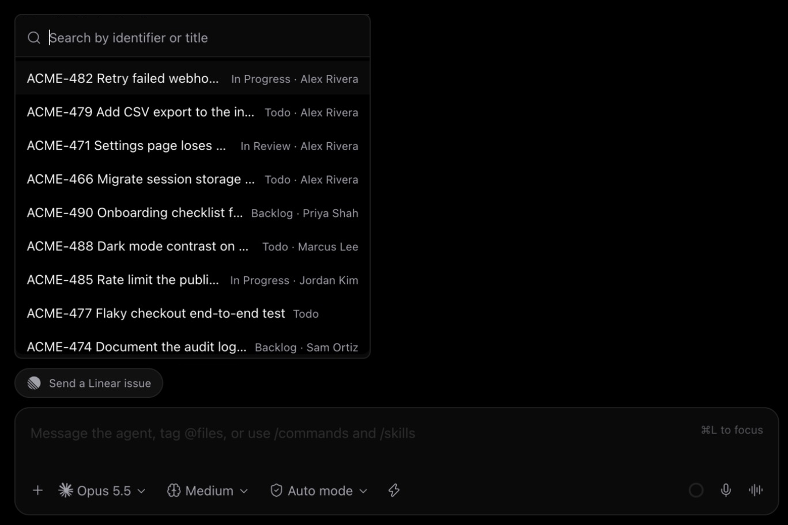

# Linear for Paseo

A [Paseo](https://paseo.sh) plugin to find Linear issues from the composer and send them to an agent.



- **Send a Linear issue**: a Linear button in each agent's composer opens a search popover. Pick an issue, add an optional message, preview the exact text, and send it. If the agent is busy, the issue steers the current turn.
- **Attach Linear issue**: an issue picker in the composer's + menu adds the issue as an attachment to the message you are writing.

Search an identifier such as `ENG-1234` for an exact match, or type text to match titles. Your assigned issues come first, then other issues, up to 30, by most recently updated.

## Setup

1. Turn on **Enable plugins** in Paseo under Settings > Plugins, then install the plugin:

   ```bash
   paseo plugin add git:EthanL06/paseo-linear
   ```

2. Create a personal API key in Linear: Settings > Security & access > Personal API keys.
3. In Paseo, open Settings > Plugins, choose **Connection** in the Linear plugin's menu, and paste the key. The key is checked as you type and saved when Linear accepts it.

Instead of step 3, you can set `LINEAR_API_KEY` in the Paseo daemon's environment and restart the daemon. A key saved in Settings takes precedence.

Requires Paseo 0.11.4 or later.

## Data

The API key is stored in the plugin's settings on the Paseo host (or read from `LINEAR_API_KEY` there). The host sends requests only to `https://api.linear.app/graphql` and only reads data. The issue text you send goes to the agent, and so to its provider. The app keeps recent search results in memory until Paseo restarts.

## Development

```bash
npm install
npm run typecheck
npm test
paseo plugin add /absolute/path/to/paseo-linear
paseo plugin reload linear
paseo plugin logs linear
```

## License

Apache License 2.0. This plugin started from Paseo's `plugin-examples/linear`. See [NOTICE](NOTICE).
